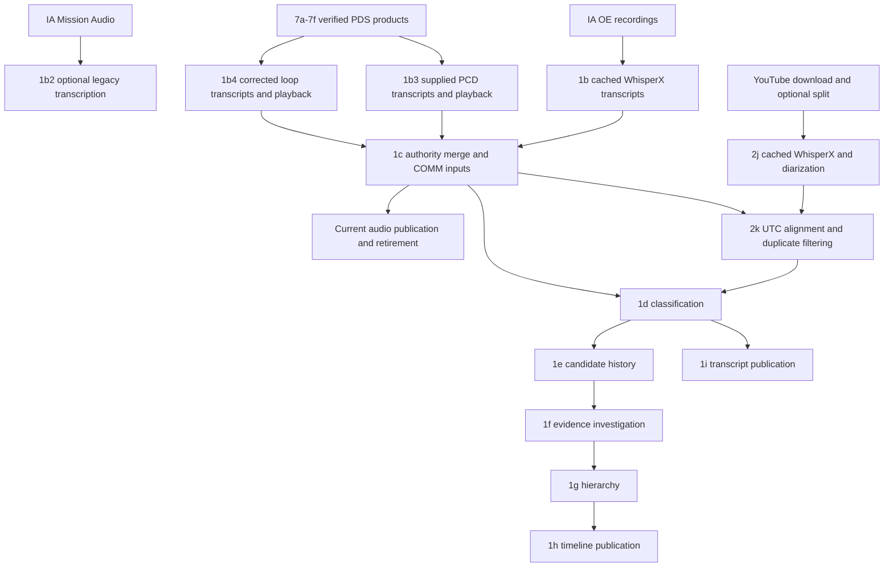

# COM, PAO, and video pipeline audit and consolidation plan

Audit date: 2026-11-07. Repository baseline: `b9b9f4d`.

Implementation started against this baseline on the same date. See [implementation results and operating limits](comm-consolidation-implementation.md) for the code now present, real migration receipts, validation, and the source/hosting cutovers that remain unverified. The numbered findings below describe the original audited state; they are not instructions to rerun its obsolete stages.

Deployment update: the user identified the existing local WSL rsync script and
chose direct upload/replacement for this hobby project. The maintained
[asset publication command](asset-publication.md) now runs that workflow from
the batch pipeline. Remote transactional release deployment is not required.

Scope: this is a joint plan for `1_comm` and `2_video`, with `7_pds` as a verified-source provider. Video transcription, duplicate removal, split/upload identity, synchronization, and web video publication are part of the consolidation—not external prerequisites. The detailed measured audit centers on speech and its playback dependencies; the video-stage inventory below defines the associated implementation scope without claiming a full codec or visual-coverage audit of every video holding.

## Recommendation

Keep the existing source recordings and completed HGX research, establish one versioned transcript dataset, and publish only its playback dependencies. Make source reconciliation, classification, historical research, and web publication independently runnable. Do **not** use a full pipeline rerun to migrate the existing data.

Following the user's PAO-source clarification, the preferred target is **IA PAO/Mission Audio as the primary broadcast-audio source, with a shared transcript synchronized to the uploaded YouTube videos**. Retire YouTube transcription and duplicate removal from routine work once coverage is verified. Keep YouTube-only transcript intervals as explicit exceptions where IA coverage is absent. This supersedes the initial recommendation to repair and retain `2k` as a permanent stage; the current-flow diagram below remains an audit of existing behavior.

Much of the intended consolidation already exists in code: supplied PDS transcripts take priority, unused audio is removed from the web tree, and classification is separated from event research. The immediate problem is that the on-disk results still use the previous pipeline contracts. The new code cannot simply resume those completed results. A compatibility import and finer-grained cache identities are needed first.

The original audit read repository code, local manifests, normalized transcripts, saved model results, and web assets. It checked selected artifact hashes, audio references, file sizes, and hard-link identity. The follow-up also read current IA collection metadata and sampled text correspondence between cached IA and YouTube transcripts. The audit itself made no pipeline changes. Subsequent implementation imported the legacy dataset, reconstructed source projections, measured audio correspondence, and staged a web release without transcription, HGX requests, source deletion, downloads, or uploads. Production hosting remains unverified; measurements below describe local holdings, not confirmed Internet storage or traffic.

## Mission-wide source policy

Define the preferred PAO source explicitly over mission UTC, including prelaunch and post-splashdown coverage. YouTube coverage outside the IA recording period is a normal part of this policy, not a reason to retain the old duplicate-removal pipeline. We do not need one recording source to cover the entire mission.

| Broadcast coverage interval | Preferred PAO audio/transcript source | Video behavior |
| --- | --- | --- |
| Before verified IA PAO coverage begins | Existing YouTube-derived transcript and corresponding broadcast audio | Play the mapped uploaded YouTube video where available. |
| IA and YouTube both cover the same broadcast content | IA PAO is the preferred recording; preserve accepted transcript wording/labels during migration | Continue YouTube video using the verified synchronization map. |
| IA-covered interval without corresponding YouTube coverage | IA PAO | Audio/transcript remain available; do not imply video exists. |
| Confirmed gap or unusable interval within IA PAO coverage, with usable YouTube coverage | YouTube for that explicitly bounded interval | Use the corresponding video and its own timing map. |
| End-of-mission overlap | Prefer IA while its usable coverage continues; choose a verified handoff within the overlap if switching is needed | Video can continue across the audio-source handoff. |
| After IA PAO ends, while YouTube broadcast coverage continues | YouTube through the end of the selected broadcast coverage | Retain recovery/postmission coverage rather than truncating at splashdown or the end of IA files. |
| After YouTube ends, while IA PAO continues | IA PAO through its usable coverage | Continue audio/transcript without video. |
| Neither source covers an interval | Explicit coverage gap | Do not invent continuity, speech, or a playback mapping. |

These rules apply to the **PAO broadcast channel**. OE-1/OE-2 and onboard PCD retain their separate authority rules. The start or end of OE communications coverage does not itself determine when PAO should switch sources.

The current `2026-04-01T17:00:04Z` start of the cached IA Mission Audio holding is a **candidate opening boundary**, not an approved handoff. Verify the first usable broadcast passage and its relationship to YouTube. Determine the closing boundary independently from the last usable IA audio and the ends of the relevant YouTube broadcasts; no closing timestamp has been established by this audit. Check both ends for additional coverage, overlap, different content, and recording delays. A first/last filename or a mission-event timestamp alone is insufficient.

Implement the policy as a small, reviewed source-coverage manifest: mission UTC start/end, broadcast/feed identity, selected recording source, reason, verification status, and references to transcript/playback mappings. Use nonoverlapping half-open intervals (`[start, end)`) for selection within one broadcast feed. Overlapping recordings remain available as alternatives; distinct broadcasts are not automatically treated as equivalent. Adjacent intervals with the same policy can be merged. Unknown intervals stay explicit until reviewed.

Source selection answers **which recording to use at this mission time**. The separate synchronization map answers **where that time is in each recording or uploaded video**. At each handoff, validate the last passage from the outgoing source and the first from the incoming source, select a natural utterance boundary, and ensure no speech is lost or presented twice in the canonical PAO sequence. Keep source occurrences and provenance even when one occurrence is selected for display. Changing only this selection/mapping must not trigger HGX reanalysis of unchanged text and context.

## 1. What the pipeline actually does

The recordings are overlapping sources, not interchangeable copies. OE-1 and OE-2 are distinct channels. IA Mission Audio is a separate mixed recording dominated by broadcast content. YouTube adds PAO commentary and rebroadcast communications. PDS adds both onboard PCD recordings and corrected versions of selected voice loops.



`1b2` has no edge into the canonical dataset: `1c` explicitly excludes `MISSION_AUDIO` JSONs. The diagram describes current code, not a claim that all corresponding new-stage artifacts exist locally.

| Stage | Current responsibility | Retain / simplify |
| --- | --- | --- |
| `1a` | Download IA ZIPs and extract recordings; catalog-only mode also exists | Retain as explicit intake; stop coupling retrieval to ordinary publication. |
| `1b` | WhisperX for IA OE audio; cached transcript JSON and AAC | Retain as fallback for uncovered/new material. Existing outputs should be reused. Eventually skip new ASR where verified supplied coverage is sufficient. |
| `1b2` | Standalone IA Mission Audio transcription | Reuse its existing transcripts as the candidate PAO source. Add a PAO-specific import/preparation path; do not put broadcast rows into OE COMM. Run new ASR only for verified gaps without cached text. |
| `7a`–`7g` | PDS discovery, inventory, reuse, download, verification, catalogs, reporting | Keep archival retrieval separate. `7f` catalogs are the COM import boundary; do not download the archive again for transcript work. |
| `1b3` | PCD import, supplied CSV/SRT timing and speakers, playback encoding; ASR fallback | Keep. Supplied/pending-transcript handling avoids unnecessary WhisperX. |
| `1b4` | Corrected loop CSV import and AAC remux | Keep. No model needed. |
| `1c` | Filter machine artifacts, merge corrected authority, create COMM inputs, reconcile audio | Keep merge logic; separate preparing inputs from retiring audio from an active web release. |
| `2d/2e/2h/2i` | YouTube metadata, download, splitting, optional upload | Metadata is useful; download/split are conditional intake. Upload is a separate distribution operation, not a prerequisite for transcript publication. |
| `2j` | Transcribe downloaded parts, optionally diarize, save JSON | Preserve cached text for migration and gap checks. Retire routine YouTube ASR for intervals covered by IA PAO. |
| `2k` | Align cached YouTube text to UTC, remove COMM duplicates, write PAO input | Replace with PAO source selection and a video synchronization map. Keep old outputs as audit evidence; do not make repair of this deletion algorithm a prerequisite for the new architecture. |
| `1d` | Category, importance, tags, topic, statement kinds, thread context, PAO type | One classification stage. Seed it from existing accepted labels instead of classifying the whole mission again. |
| `1e/1f` | Discover developments, then verify claims against original evidence | Keep as an optional research branch. Neither should be required to rebuild transcript UI assets. Preserve completed investigations. |
| `1g/1h/1i` | Deterministic hierarchy, timeline, and transcript projections | Retain; make publication work from an explicitly selected compatible dataset with zero model calls. |

Implementation evidence: [runner](../run_all.py), [COMM preparation](../1_comm/1c_prepare_comm.py), [PDS loop handling](../shared/pds_loops.py), [PCD handling](../shared/pds_comm.py), [YouTube reconciliation](../2_video/2k_filter_yt_transcript.py), [transcript publication](../1_comm/1i_web_transcripts.py).

### `2_video`: stage-by-stage disposition

Treat video acquisition/distribution, speech sourcing, and synchronization as separate operations. Retiring YouTube ASR and duplicate removal does not retire video playback or the video catalogs.

| Video stage | Role in the joint plan | Proposed disposition |
| --- | --- | --- |
| `2a_ia_video_discover` | Discover IA video candidates | Keep as explicit catalog intake. A video candidate is not automatically a PAO audio source or a hosting requirement. |
| `2b_ia_video_download` | Download IA MP4s; also supports coverage planning | Keep selected/resumable intake. Preserve existing coverage decisions and avoid downloading video merely to rebuild transcripts. |
| `2c_io_nasatv_download` | IO catalog, downloads, and `videoIO.json` builder | Keep metadata/provenance and existing publication eligibility rules. `2g` calls its web builder; do not remove it because it is absent from the runner's step registry. |
| `2d_yt_metadata` | Original YouTube video identity and metadata | Keep. Reconcile these IDs with separately uploaded part IDs; title, publication date, or upload date does not prove the media's mission-time offset. |
| `2e_yt_download` | Local YouTube source media | Make conditional acquisition/archive work. Existing local media suffices for bounded alignment checks; metadata refresh must not force redownloads. |
| `2f_ia_video_metadata` | IA timing/description projection consumed by video publication | Keep until its consumers are deliberately migrated. Do not drop it merely because the runner calls it legacy. |
| `2g_web_video` | Publish IA/YT/PDS/IO video indexes | Keep as a model-free video publication step. Extend publication to reference the verified sync mappings and selected uploaded videos, while preserving existing catalog consumers. |
| `2h_split_mkv` | Produce video parts for distribution | Keep as explicit preparation for new/changed videos. Persist original offsets, actual durations, file identity, and cuts in a durable part manifest. Existing parts should not be recreated for a transcript change. |
| `2i_yt_upload` | Upload parts and save filename-to-uploaded-ID state | Keep as a separate distribution operation. Import `.yt_upload_state.json` into the durable video/part mapping; routine builds reuse IDs and never re-upload. This plan does not request an upload. |
| `2j_transcribe_yt` | WhisperX, alignment, optional diarization, completed/progress JSONs | Reuse saved results for opening/closing coverage, internal gaps, and alignment evidence. Remove from routine builds after cutover; retain only an explicit fallback for uncovered material without usable cached text. |
| `2k_filter_yt_transcript` | UTC assignment, COMM duplicate removal, PAO CSV preparation, diagnostic exports | Split responsibilities. Preserve timing evidence; replace PAO preparation with the reviewed source-coverage policy; retire speech deletion and speaker promotion from routine builds. Compatibility code may still read historical outputs. |
| `2l_ia_originals` | Retrieve selected originals where the saved IA plan lacks MP4s | Keep as explicit acquisition using its existing selection rules. It is not a prerequisite for PAO transcript reconciliation. |

Evidence: [video pipeline files and README](../2_video/README.md), [2g publication](../2_video/2g_web_video.py), [2h splitting](../2_video/2h_split_mkv.py), [2i upload state](../2_video/2i_yt_upload.py), [2j transcription](../2_video/2j_transcribe_yt.py), and [2l original retrieval](../2_video/2l_ia_originals.py). The standalone scripts and calls between modules must be included when updating instructions; the runner registry alone is not the full video pipeline.

### Shared contracts between the pipelines

The following are proposed responsibilities, not additional commands that already exist:

| Artifact / decision | Owner | Consumers and invariant |
| --- | --- | --- |
| Verified PDS products and source metadata | `7_pds` | `1_comm` imports supplied transcripts; `2_video` consumes video products. Archive availability does not itself select the preferred broadcast feed. |
| Recording/transcript ledger, PAO source-coverage manifest, classification/history | `1_comm` | One canonical speech dataset for transcript UI and video-linked text. Source changes use the impact planner; video catalog rebuilds cannot relabel it. |
| Video catalog and original → part → uploaded-ID map | `2_video` | Synchronization and player selection use exact identities/durations. Preserve local part identity after upload. |
| Verified piecewise audio/UTC/video synchronization map | `2_video`, using the shared recording and utterance IDs | Both transcript and video publication consume the same version. It stores relationships and confidence, not a second independently edited transcript. |
| Final transcript, audio, video-index, and sync assets | Shared release publication | A release pins compatible versions and validates every published relationship before activation. Changes to filenames or video URLs alone do not invalidate HGX work. |

The intended dependency flow is:

```text
7_pds verified text + IA OE/PAO + cached YouTube exceptions
    -> 1_comm source policy and canonical speech ledger
    -> reused/targeted classification -> transcript projection

2_video catalogs + original/part/upload identity
    + canonical speech IDs and alignment evidence
    -> verified synchronization map -> video index/sync projection

transcript projection + selected audio + video index/sync projection
    -> validated shared release
```

Both projections read shared artifacts; neither should require the other to publish a live web file first. Keep alignment evidence private and publish only the compact mappings the player needs. A missing video mapping must not block otherwise valid audio/transcript publication; expose that interval as having no mapped video. A broken mapping must never silently select the wrong video/time.

For migration, preserve `processed/transcripts/yt/*_part*.json`, partial-transcription checkpoints, `_stream_start.json`, `_transcript.csv`, `_dedup_matches.json`, `_comm_speakers.json`, and the split/upload state. Their value is evidence and recovery, even when `2j/2k` cease to run. Import useful data into the shared contracts without re-running transcription or trusting old duplicate-removal decisions as authoritative coverage.

## 2. Measured local baseline

Paths are mission-relative unless stated otherwise. `F:` means `F:/_repos/ArtemisInRealTime_assets/artemis-ii`; bulk originals are under `D:/ArtemisInRealTime_assets/artemis-ii`. Sizes are logical bytes; GB/MB below are decimal. They are not additive physical-disk measurements because hard links share storage.

| Holding | Observed amount | Consequence |
| --- | --- | --- |
| `F:raw/comm` | 65,323,011,660 bytes; 5,650 WAVs and 20 ZIPs | Archive/private intake, not a hosting requirement. |
| IA Mission Audio within that directory | 3,294 WAVs, 45.08 GB; 10 ZIPs, 16.56 GB | Largest COM-specific raw holding; currently excluded from canonical COMM. Candidate primary PAO source; originals remain private. |
| Other IA COM WAVs / ZIPs | 2,356 WAVs, 3.16 GB; 10 ZIPs, 0.53 GB | Retain originals and archived packaging; do not infer duplicate bytes from overlapping speech. |
| `F:processed/comm_audio` | 3,662,206,855 bytes including retired encodes | Processing cache, not a second public audio library. |
| `F:web/comm` | 1,981 files, 936,509,515 bytes | All 1,981 are hard-linked to the corresponding cache files locally. Uploading both paths would still create unnecessary hosted objects. |
| Audio referenced by `web/transcripts.json` | 1,968 distinct files; zero missing | 13 published files, totaling 2,481,803 bytes, are absent from the final transcript's reference set. Investigate all consumers before retiring them. |
| Integrated PDS audio catalog | 53 PCD products, 687,170,314 source bytes; 3 loops, 96,424,223 source bytes | PCD is a separate onboard channel; corrected loops cover only selected intervals. |
| Published PDS playback | 53 PCD M4As, 261,306,785 bytes; 3 loop M4As, 96,424,160 bytes | PCD is already mono AAC at 22,050 Hz / 64 kbps; loop AAC is remuxed without raising its bitrate. |
| Integrated PDS transcript catalog | 228 entries: 214 PCD and 14 loop representations | Representation count is not recording count. Preserve original formats/labels without publishing every representation. |
| Normalized PDS text | PCD: 5,208 segments; loops: 1,144 timed and 3 untimed segments | Supplied speaker names are present on 5,152 PCD and 1,122 loop segments before downstream deduplication. |
| Loop merge report | 1,240 AI utterances superseded; 4 boundary overlaps, 1 over one second | Existing replacement audit must survive consolidation. Do not treat the whole labeled day as corrected coverage. |
| `web/transcripts.json` | 15,561 COMM + 37,309 PAO = 52,870 entries, all categorized | Current local publication is complete under its historical contract. 6,235 COMM entries have a separate speaker value. |
| YouTube transcription | 29 saved part JSONs; 33 total files in `processed/transcripts/yt`, 32.17 MB | Reconciliation can use these small cached files without rereading or retranscribing video. |
| Configured YouTube mission download directory | 213 files, 372,870,444,033 bytes, including partial/temp files | Whole mission download holding, not just the transcribed live stream. Its top-level listing did not contain the named `*_part*.mp4` sources. Follow-up located the 63,968,242,301-byte live-stream MKV at `D:/NASA Artemis II Live Mission Coverage m3kR2KK8TEs.mkv`, outside that directory; split/upload mapping still needs locating. |

The loop/PCD import and audio reconciliation reports are dated October 31; they describe that saved run. File/reference measurements were taken during this audit. The entire PDS archive was not rescanned or rehashed.

## 3. Findings that affect correctness and cost

### A. Current code and saved results are incompatible without an explicit bridge

The checked-in code expects `inputs/`, `1d_enrichment/utterances.jsonl` plus `report.json`, and `1e_discovery/`. Locally:

- `processed/transcripts/inputs/` does not exist. Old `web/comm.csv`, `web/PAO.csv`, and `web/comm.json` are also absent.
- `1d_enrichment/` contains the old `enriched_utterances.jsonl`, candidate milestones, and diagnostics, not the new canonical manifest and ledger.
- `1da_classification/labels.jsonl` contains **52,870 completed classifications**; its saved artifact hash matches.
- `1e_recovery/` and `1ea_labeled_history/` remain populated; `1e_discovery/` does not exist.
- `1f_investigation/` is a completed **version 1** dataset with **8,180 verified events**, **154 unresolved events**, and zero pending tasks in its report. Current investigation code declares version 3 and expects discovery metadata absent from that older contract.
- Artifact hashes for the four standard outputs in each of `1e_recovery`, `1ea_labeled_history`, and `1f_investigation` match their saved manifests. The current transcript publication's three artifact hashes also match. That verifies stored outputs, not the now-missing or changed upstream dependencies.
- The saved `1i` report identifies `1ea_labeled_history` as its source. Current `1i` reads the new `1d_enrichment` contract.

Consequently, even a nominally model-free `1i` rebuild cannot currently consume these holdings as configured. Running `1c 2k comm-history` would prepare new inputs and enter the new model workflow; it is **not** an existing-results migration command.

The legacy label ledgers also lack `pao_type` on all 37,309 PAO rows, while the published JSON contains 12,179 `commentary`, 6,934 `filler`, and 18,196 `other` values. Preserve those published values as a separately identified legacy projection while tracing their derivation; do not silently label them as new constrained-model assessments or recompute every label to fill this one field.

An in-memory reconstruction of legacy PAO CSV from `1ea_labeled_history` exactly reproduced its recorded SHA-256 when using CRLF. COMM reconstruction did not: the old merge report has 15,619 rows versus 15,561 published/ledger rows. Restore original source projections from normalized files or a verified backup; do not fabricate a matching manifest from the deduplicated web output. Resolve the 58-row difference explicitly.

### B. Resumption is currently scoped to a whole dataset snapshot

In [1d](../1_comm/1d_enrich_transcripts.py), the work-directory identity includes both complete input CSV hashes, model settings, batch/context sizes, prompt, and schema. Accepted rows are resumed only inside that identity. Changing one input row, an audio path, CSV formatting, or an input location can select a new work directory and leave all prior successes unused.

[1e](../1_comm/1e_discover_history.py) additionally incorporates the classification report and full media/itinerary hashes. [1f](../1_comm/1f_investigate_history.py) includes discovery artifacts, the full source index, reference hashes, settings, and investigation contract. Their checkpoints are useful for interrupted identical runs, but they are not incremental caches across evolving source datasets.

The [current UID](../1_comm/transcript_common.py) primarily hashes channel, exact timestamp string, and text. Speaker prefixes are embedded in CSV text, so adding attribution changes identity. Playback offset/duration are not in that UID, but changing them still changes the full CSV cache key. Different loop identities receive an additional disambiguation only after a collision. This needs a migration map, not a wholesale UID rewrite.

### C. PDS attribution is authoritative source metadata, not HGX speaker identification

`1b3` and `1b4` import speakers directly from supplied transcripts. `1c` preserves separate names in structured JSON and prefixes CSV text for batch consumers; `1i` removes that prefix from display text. HGX classification does not identify speakers. Discovery/investigation `crew` describes involvement in an activity and is not a reliable substitute for who spoke.

Preserve these distinctions:

1. Recording channel: OE-1, OE-2, PCD, PAO, or unknown.
2. Supplied speaker identity/role, including CAPCOM or unknown, with source row provenance.
3. Anonymous diarization cluster within a particular recording/part.
4. Crew involved in a reported event, with supporting evidence.

Corrected loop CSV UTC and audio offsets are independent clocks; compressed recordings omit mission-time intervals. Keep interval authority, clock cuts, repairs, and untimed rows. PCD uses label/exact-ID UTC and CSV utterance UTC with SRT playback support. Never apply the IA timezone adjustment to PDS or overwrite UTC with subtitle offsets.

PDS does not currently replace all OE or PAO coverage. Keep IA text/audio outside corrected same-channel coverage; keep PCD independently. Propagating a named PDS speaker into another recording would require an explicit, checked correspondence, not just nearby time or a shared HGX crew label.

### D. YouTube duplicate removal needs review before further reduction

Saved `_dedup_matches.json` contains 22,161 removals: 11,228 text matches and 10,933 speaker promotions. **8,200 are flagged low confidence.** A flag is a review signal, not proof that all these removals are wrong.

There is also a concrete scope defect: `2j` records anonymous `SPEAKER_*` IDs per part; `2k` carries those strings unchanged and pools speaker statistics across all parts. The local data has 85 speaker strings reused in multiple parts. The same string is not evidence of the same person across independent diarization runs. Once promoted, all of that cluster's other rows can be removed, including rows with no COMM anchor (`promoted_no_anchor`).

If the old algorithm is used during comparison or for an exceptional uncovered interval, repair the key to include recording/part identity and require a defensible duplicate relationship before suppressing a row. The preferred replacement does not depend on speaker promotion: compare IA PAO against **unfiltered** cached YouTube text and select the covered source. Retain original removal decisions for audit, and classify only newly restored/changed rows after incremental reuse exists. Neither comparison requires a new WhisperX pass.

Preserve stream start `2026-04-01T11:43:14.521Z` and actual part-duration offsets unless evidence justifies a change. The implementation uses cumulative JSON durations, despite stale descriptions of fixed-size parts. Validate missing/duplicate parts and record explicit part offsets; a missing part must not silently shift every later utterance. Preserve part ID and playback offset in canonical PAO records—the current two-column PAO CSV discards that relationship.

The `1c` comment claiming roughly 89% overlap for IA Mission Audio is historical justification, not proof that YouTube covers IA or that IA covers YouTube. It should not determine the future source choice. Measure coverage in both directions before retiring either source from routine transcription.

### E. Audio retirement is tied to preparation, not the final published release

`1c` already validates playback files, publishes referenced cache files, and retires unreferenced files with receipts. Preserve this useful behavior. However, its reference set comes from intermediate COMM rows, while the app reads `1i`'s `transcripts.json`.

This explains a reference-set discrepancy to investigate: 1,981 intermediate-selected files versus 1,968 final-publication references. More seriously, a future `1c` may retire files still needed by the previous `transcripts.json` before a subsequent classification/publication fails. `1c` and `1i` have separate locks and no shared release transaction.

Build the release in staging, validate references against the final JSON, publish assets before switching the release index, and retire old assets only after the previous release's retention period. Keep the union of active and rollback release references during transition.

### F. Runner and documentation need an operational cleanup

- The default runner includes retrieval, WhisperX, and HGX. It is not a cheap refresh command.
- It registers `2j`, but passes no `--input-dir`; `2j` requires that argument. Thus the advertised default all-steps path cannot complete as currently wired.
- `pds-integrate`, `pds-refresh`, `pcd-comm`, and `loops-comm` can change COMM inputs/audio but do not run `2k` or publish updated classified transcripts. They are intake/preparation groups, not complete web refreshes.
- `refresh_assets.py --stage build` runs `7f`, `1c`, and `1i`, but omits PCD/loop import and PAO reconciliation. It can miss newly cataloged transcripts or stop at a stale/missing classification manifest after modifying audio. It also changes media references that can invalidate old history manifests.
- README descriptions still mention `web/comm.json`, `combined_transcript.json`, and older 2k behavior. The actual [client](../../data/comm.ts) fetches `transcripts.json`; the timeline client fetches `timeline.json` and referenced crew tracks.

### G. IA PAO can replace the YouTube transcript branch, subject to coverage

The candidate identified locally is the `Artemis II Mission Audio` delivery in the [IA ACR collection](https://archive.org/details/Artemis-II-ACR-Collection). Its live metadata, checked on 2026-11-07, lists the same ten daily Mission Audio ZIP names/sizes as the local source catalog, alongside ten Orion-to-Earth ZIPs. This does not establish that every NASA YouTube broadcast used the same feed. If a different PAO collection is intended, add it to the same comparison rather than assuming it is this holding.

Additional read-only findings:

- 3,282 cached `MISSION_AUDIO` JSONs contain 9,626 segments. Their recording envelopes total approximately 70.94 hours after merging overlaps. There are 3,294 raw WAVs, so inspect the twelve-file difference; skipped short/silent recordings are one possibility, not an established explanation.
- The earliest cached IA recording starts at `2026-04-01T17:00:04Z`. The published PAO dataset has **1,043 entries before that**, beginning at `11:45:01.894Z`.
- Of the 37,309 published PAO utterance start times, 19,708 fall inside those IA recording envelopes and 17,601 outside. This is only a clock/coverage screening result: recording gaps, timestamp error, broadcast delays, and the twelve missing transcript outputs need investigation. It is not a text-equivalence or missing-speech count.
- A deterministic preliminary sample selected 200 recordings evenly through the chronological list of 2,808 IA recordings with an utterance of at least twenty normalized words. It searched a central ten-word phrase from each recording's longest utterance in all **unfiltered** cached YouTube parts, allowing phrases to cross transcript-segment boundaries within a part. **179/200** phrases appeared; **178/200** appeared within five minutes of the IA utterance start. This supports substantial shared content, but is neither a mission-wide coverage percentage nor precise audio alignment. ASR errors can explain unmatched phrases; replayed speech can produce misleading matches.

The proposed target is:

```text
IA PAO audio + existing transcript ----> canonical PAO text and audio mapping
verified YouTube-only gaps -----------> explicit exception rows
                                            |
                     existing labels + selective new/changed-row assessment
                                            |
                      one transcript with alternative playback mappings
                         /                              \
                  IA PAO playback               uploaded YouTube video
```

Confirm it without restarting HGX or WhisperX:

1. **Inventory the intended scope.** Enumerate IA recordings, every video/re-upload intended for the site, exact durations, original and uploaded IDs, and the split/upload manifest. The existing upload script writes `.yt_upload_state.json` beside its input files; locate it and reconcile the mapping. The 29 transcribed live-stream parts are not evidence about all other YouTube broadcasts, special events, or alternative camera feeds.
2. **Align cached text in both directions.** Match distinctive phrases and multi-utterance windows, tolerating different ASR segmentation. Use order, multiple independent anchors, and timestamp consistency; reject ambiguous repeated countdowns, reused footage, and generic short responses. Produce interval maps plus IA-only, YouTube-only, uncertain, silence/music, and missing-recording intervals. Check the earliest/latest coverage and every recording/part boundary. Never use filtered PAO alone as the reference: it already omits 22,161 YouTube rows.
3. **Confirm audio at the anchors.** Decode bounded local audio windows and compare acoustic fingerprints or normalized waveform correlation around the proposed matches. Different encodes, gain, channels, and silence mean file checksums cannot establish feed equality. Verify samples across each mapped interval and around every detected edit; flag drift, delay changes, voice-overs, alternate mixes, and repeated inserts. No model transcription is needed for this validation. Inspect questionable matches by listening, and retain uncertain intervals rather than declaring them duplicates.
4. **Persist piecewise synchronization.** Store recording ID, source audio range, transcript row IDs, mission UTC range, original video ID, uploaded video ID, video range, anchor evidence, residual timing error, and confidence. For a continuous interval, map source offset `a` to video offset `v = v0 + rate * (a - a0)`; use `rate = 1` unless measured drift justifies another value. Start a new interval at a cut or changed delay. Never apply one mission-wide offset across concatenated IA clips, edited videos, or re-uploads. An example review gate is multiple distributed anchors and at most one second residual at checked anchors; measured error and listening checks, not that threshold alone, establish acceptance.
5. **Select sources conservatively.** Prefer IA PAO where speech and timing correspondence are confirmed; retain the cached YouTube transcript for uncovered/uncertain speech and identify its provenance. Keep visual content even where its audio duplicates IA. Allow an IA passage to have several video mappings and a video to contain unmapped intervals.
6. **Retire routine YouTube processing only for proven coverage.** Coverage is complete when every in-scope speech interval has a selected source or an explicit reviewed exception, with no unexplained losses. This can remove `2j/2k` from normal builds even if a small frozen YouTube-derived exception set remains. Removing their routine dependency does not mean deleting cached transcripts, source media, or audit evidence.

The cheapest first migration is to attach verified IA playback mappings to existing accepted transcript rows while retaining text, UTC, legacy IDs, classifications, and citations. That changes the preferred playback source without automatically replacing the transcript wording. Where IA transcription is chosen as the better text, represent that as a revision and reuse labels only where semantic/context equivalence is demonstrated. Many-to-one matches must not silently duplicate assessments. New or corrected content gets targeted work after Phase 3.

Switching source audio does **not** eliminate speech repeated between PAO and OE channels: the IA PAO feed may contain the same crew calls. Keep those as distinct channel occurrences with optional correspondence links. A combined UI can group matched occurrences or choose preferred playback without deleting source rows. This removes the need for the current destructive YouTube-versus-COM duplicate-removal stage while preserving the ability to listen to the PAO broadcast continuously.

## 4. Target data and authority model

Use a versioned canonical transcript ledger with deterministic compatibility projections for existing CSV consumers. Start as an adapter over existing files; a database rewrite is unnecessary.

| Record | Required identity / provenance | Separate mutable concerns |
| --- | --- | --- |
| Recording | Stable recording ID, logical channel, origin, PDS LIDVID/NASA ID or IA/YT identity, content hashes and aliases | Local path, playback derivative, encoding profile, public URL |
| Utterance | Stable source row/segment ID within its recording; original text, UTC, playback interval, speaker and origin | Preferred text revision, normalized display name, authority status, semantic revision |
| Correspondence | Original and preferred utterance IDs; same-channel coverage or checked duplicate mapping; reason and boundary evidence | May be one-to-many or many-to-one; never assume a one-to-one label transfer |
| Assessment | Utterance semantic revision, supplied context identities/hashes, model/prompt/schema provenance, accepted fields | Category, importance, topic, tags, statement kinds and PAO type remain independently represented |
| Investigation | Stable candidate/claim identity, evidence source revisions, retrieval trace, verdict, unresolved state | Keep event time distinct from report time; speakers distinct from involved crew |
| Release | Dataset and assessment versions, final asset references, hashes, byte counts, prior release | Web formatting, storage paths, compression and cache headers |

Selection order: verified supplied PDS loop text for its covered channel/interval; retained IA OE text outside that authority; supplied PCD as an independent channel; IA PAO/Mission Audio as the preferred broadcast source after verification, with cached YouTube text for explicitly uncovered intervals. Preserve accepted wording during the initial playback-source migration. PAO rebroadcasts of OE calls remain separate channel occurrences, linked rather than destructively removed. Originals, superseded rows, and alternative representations remain privately addressable.

Maintain legacy UIDs as aliases so existing citations and event anchors still resolve. Separate physical recording identity from logical channel and from a deduplicated utterance. Normalize timestamp representations without changing their meaning or silently changing legacy IDs.

## 5. How to preserve HGX work

### First import the baseline without model calls

1. Snapshot the relevant manifests, source projections, labels, research ledgers, work directories, source snapshots, and web release. Record hashes and the producing Git revision where recoverable. Preserve current files in place; old directories are not disposable merely because the runner stopped referencing them.
2. Recover COMM/PAO source projections in a separate staging location. Compare exact hashes where possible and semantic rows otherwise, accounting for CRLF, duplicate rows, UTC formatting, and speaker prefixes. Report every unmatched identity and the 58-row COMM difference.
3. Seed canonical assessments from `1da_classification/labels.jsonl`, joining exact legacy identities to source rows. Use `1ea_labeled_history` for the already-applied classification overlay and `1f_investigation` for verified events, citations, retrieval traces, and unresolved outcomes. Do not let old `1f` categories overwrite the newer classification set.
4. Preserve published PAO-type values with explicit legacy-projection provenance until their generating rule is recovered. Validate missing fields separately; never infer filler solely from importance or subject.
5. Write an explicit legacy-import manifest and compatibility reader. Do not rename old results to look like new `1d/1e/1f` output, edit historical hashes to pass validation, or fabricate a successful new discovery run. Existing history may remain a pinned legacy evidence dataset while new research uses the new contracts.
6. Rebuild a staged transcript/timeline projection and compare it to the saved release. Initial acceptance is zero model requests, equivalent text/timing/audio/labels, preserved 8,180 verified events and 154 unresolved outcomes, and intact evidence resolution. Formatting/metadata differences must be explained.

### Then make reuse selective

Add a read-only impact planner before any model execution. It should report accepted/reused/new/changed/removed rows, affected context windows, affected investigations, estimated requests, and the precise invalidation reason. Expose explicit model-work limits; the existing `--history-limit` bounds work only after choosing a snapshot and is not a migration/reuse planner.

Cache classifications by semantic input and actual supplied context, with model, prompt, schema, and validator versions. Use path-independent source identities and canonical serialization. Preserve row-level successes across dataset revisions and transport batching changes when the model-visible inputs are equivalent. Batch position, file path, JSON whitespace, or a whole unrelated CSV hash should not by itself discard all labels. Where grouping changes the supplied context, conservatively invalidate that affected group.

Cache discovery by target source revisions, classification dependencies, and relevant context. Cache investigations by claim/evidence/search dependencies. Newly available contradictory evidence can matter even if the cited quote did not change: mark affected time/topic/source searches stale and review that subset. A label-only edit does not automatically invalidate an evidence-supported event, although hierarchy/category projections may need rebuilding.

| Change | Required work | Work to reuse |
| --- | --- | --- |
| JSON formatting, compression, hosted URL, cache directory | Rebuild publication/provenance as needed | All semantic assessments and research |
| Audio encoding/container or playback-only offset correction | Validate seeking and update playback mapping | ASR text, labels, and claims if text/UTC/evidence meaning is unchanged |
| Display-only speaker-name normalization | Rebuild display; preserve identity aliases | Labels and history unless interpretation changes |
| Actual speaker correction, text correction, changed UTC, new utterance | Reconcile identity; assess changed rows and affected context; review affected claims | Unaffected rows and investigations |
| Corrected PDS paragraph replacing multiple AI utterances | Record supersession and remap evidence explicitly; assess changed semantics | Original work remains archived; do not spread one old label indiscriminately |
| New media/reference evidence | Update relevant context/search dependencies and impacted investigations | Unrelated classifications/research |
| New classification field or schema | Validate/import existing fields; targeted missing-field work if needed | Valid existing fields; no automatic whole-mission research pass |
| Changed historical-verification rules | Version the new contract; review incompatible claims selectively | Historical results retained with their actual contract/provenance |

## 6. Minimal hosting plan

Generate an allowlisted release manifest from actual client references. Keep the public layout compatible initially; publication can be optimized without changing transcript semantics.

| Asset | Public policy |
| --- | --- |
| `transcripts.json` | Required by current transcript/COMM views. Compact JSON and serve with negotiated gzip/Brotli. Keep COMM and PAO together initially; split/lazy-load only after measuring browser cost and updating consumers. |
| Referenced `comm/**/*.aac` and `comm/**/*.m4a` | Required for COMM playback. One derivative per selected recording; include full referenced PCD/loop recordings with existing offsets. Preserve HTTP Range seeking. |
| Selected IA PAO playback and video-sync manifest (new) | Add only the recordings needed by the chosen PAO playback experience, reusing cached derivatives. Account for this additional audio in the release budget: today's 0.94 GB COM measurement excludes Mission Audio. A sync-only experience can use hosted YouTube audio; independent PAO playback requires accessible PAO derivatives. Do not upload raw WAVs/ZIPs. |
| `timeline.json` and referenced `timeline/crew/*.json` | Required for history views. Crew tracks are loaded on demand; retain their referenced paths. |
| `comm_enriched.csv`, `PAO_enriched.csv` | No current application fetch was found. Make optional download exports or keep private unless a public download contract is intended. Current combined size: 11,390,897 bytes. |
| `comm_sources.json` | No current client fetch was found. Retain a compact public provenance index if desired; archive full provenance privately. Do not publish local drive paths unnecessarily. |
| `mission_activities.json` | No current client fetch was found. Candidate legacy export; verify external consumers before omitting. |
| YouTube video | Retain uploaded video playback and stable IDs/offset maps. Current video UI uses YouTube's player. Keep downloaded originals/chunks private for reproducibility; neither the 372.87 GB configured holding nor the separately located 63.97 GB live-stream MKV needs to be copied to the site's media host for transcripts. |
| Raw IA ZIP/WAV, PDS original variants/CSV/SRT/XML, transcript checkpoints and diagnostics | Private archive only. No second public `audioPDS`/`transcriptsPDS` collection. |

Measured serialization experiment, performed in memory:

- `transcripts.json`: **26,675,675 bytes** currently; **18,734,858 bytes** compact; **3,269,698 bytes** gzip after compaction. This reduces transferred JSON substantially without HGX, ASR, text changes, or chunked API complexity. Actual CDN headers/compression still need verification.
- `comm_sources.json`: 504,182 bytes currently; 342,921 compact; 24,453 gzip.
- `timeline.json`: already compact, 5,684,556 bytes; 1,218,330 gzip.
- The current transcript's audio reference closure is **934,027,712 bytes**. Removing only the 13 unreferenced files saves about **2.48 MB**, not hundreds of GB.

Do not transcode already compact loop audio to a higher bitrate. Avoid per-utterance audio files initially: they multiply objects and force offset/citation changes for limited demonstrated benefit. Consider shorter recording chunks or alternate speech codecs only after actual listening, seek, request-count, and bandwidth measurements show a worthwhile improvement. Keep originals and a derivative mapping if that later work proceeds.

Production verification must cover content types, CORS, `206` responses and range seeking, cache behavior, compression negotiation, and all final index references. The Vite `/pds-assets` development route exposes local originals; it is not a production deployment strategy. No hosting sync/deployment implementation was identified in this audit, so public storage totals and external CSV consumers remain unverified.

## 7. Implementation sequence and acceptance gates

### Phase 1 — Freeze and bridge the completed dataset (highest priority)

Deliver a read-only inventory/compatibility report and a model-free legacy import adapter. Start with `config.py`, `history_common.py`, the transcript source loader, and the `1i`/history readers. Keep current web assets intact while preparing a staged release.

Acceptance: every old artifact retains its hash; all 52,870 published entries have a mapped source and assessment; the COMM duplicate discrepancy and PAO-type provenance are explicit; legacy event IDs/citations resolve; no HGX or WhisperX requests occur. Any unrecoverable field is reported rather than silently regenerated.

### Phase 2 — Separate preparation, impact planning, and publication

Introduce explicit operations for source import, deterministic reconciliation, impact preview, bounded classification, optional history research, and release publication. Keep old step names as compatibility wrappers where useful. Make routine build require no model credentials. Update both `run_all.py` and `refresh_assets.py`: separate `2_video` catalog refresh, selected media acquisition, split/upload, optional fallback ASR, synchronization, and publication. After cutover, remove `2j/2k` from routine builds; preserve explicit fallback access and fix the `2j --input-dir` runner mismatch there. Do not depend on an all-steps run or automatically invoke `2e/2h/2i` to refresh transcript assets.

Move final audio retirement behind successful staged transcript publication. Build the final reference set after UID deduplication. Preserve previous-release references for rollback. A failed classification, stale manifest, missing audio file, or interrupted write must leave the active release playable.

Acceptance: unchanged input produces identical semantic output and zero model calls; failure injection leaves the active release and rollback audio complete; a publication-only operation cannot silently enter a model stage.

### Phase 3 — Add incremental assessment/research reuse

Implement the impact planner and semantic/context dependency cache described above. Import validated old work before requesting anything new. Preserve failed/unresolved tasks without automatically retrying them; retries remain explicit.

Acceptance: changing one row affects only its required context/dependencies; changing a playback path or formatting triggers no semantic analysis; an unrelated photo change does not reclassify COMM; changed evidence marks the right claims stale. Prove these properties with mocked model clients and call-count assertions, not a live HGX trial.

### Phase 4 — Establish IA PAO authority and synchronize video

Perform the bidirectional text/audio coverage study in finding G; this read-only study can begin alongside Phase 1. Deliver the reviewed mission-wide source-coverage manifest, explicitly including opening and closing overlaps, prelaunch/postmission extensions, and internal gaps. Build the separate piecewise mapping to actual uploaded YouTube IDs. Use unfiltered cached YouTube text to recover comparison coverage, bypassing the speaker-promotion deletion algorithm. Keep low-confidence old removals as audit evidence. Prefer IA PAO playback and verified source mappings; use YouTube during the manifest's uncovered intervals. Review the four loop boundary overhangs and the 58-row COMM collapse independently of the PAO change.

Acceptance: all in-scope PAO/video speech has confirmed coverage or an explicit gap; the source manifest selects one preferred source per covered interval within a feed; both opening and closing handoffs preserve speech without duplicate presentation; mapped playback is checked across starts, ends, cuts, and drift; independent channel occurrences are preserved; supplied PDS text/speakers and both clocks survive. Existing accepted text/labels remain unchanged when only playback changes; restored/revised content is classified selectively through Phase 3. New ASR is limited to demonstrable gaps without usable supplied/cached text. Normal builds no longer require YouTube transcription or the old duplicate-removal pass for verified coverage.

### Phase 5 — Publish the reduced web release

Emit the release allowlist, compact JSON, optional CSV exports, final audio closure, `2g` video indexes, and the compact synchronization projection. Reconcile uploaded part IDs into the selected video index without assuming the original `2d` catalog already describes those uploads. Validate a staged release against the current TypeScript loaders and playback offsets; check real hosting behavior before switching the active release. Produce a before/after report of object counts, logical bytes, compressed transfer sizes, and reference completeness. Preserve separately selected IA/IO/PDS video assets; sharing their audio content with PAO is not a reason to remove distinct visual footage.

Acceptance: no raw/processed holdings enter the upload set; every referenced asset resolves; channel/category/PAO filters and speaker rendering remain correct; IA clips, long PCD files, corrected-loop clock cuts, and UTC day boundaries seek correctly. Preserve a rollback release and reconciliation receipt.

### Phase 6 — Archive obsolete intermediates and update instructions

After successful import and rollback validation, classify old directories as active evidence, reusable cache, historical audit, or reproducible export. Archive old classification/recovery/relabel stages rather than deleting them as part of code simplification. Promote cached `1b2` outputs into the PAO preparation path and remove routine reliance on `2j/2k` for verified coverage, old plain web transcript indexes, and repeated labeling/recovery passes. Correct all READMEs and runner descriptions together.

Any later local disk cleanup is separate from reducing hosting. A duplicated pathname may be a hard link, and a ZIP may be the retained archival package. Produce a verified keep/retire receipt before reclaiming anything; do not promise disk savings from logical byte totals.

## 8. Validation and remaining uncertainties

Implementation should extend the existing focused suites: `test_single_classification`, `test_transcript_stages`, `test_transcript_enrichment`, `test_history_pipeline`, `test_mission_hierarchy`, `test_web_transcripts`, `test_web_timeline`, `test_pcd_comm`, `test_loop_comm`, `test_comm_audio`, and `test_comm_encoding`. Include `2_video/test_ia_video_downloads.py` when modifying acquisition/coverage behavior. Add targeted cases for the compatibility adapter, PAO coverage exceptions, repeated-phrase ambiguity, piecewise video synchronization, changed-context reuse, and release rollback. Video integration tests must cover missing/reordered parts, original versus uploaded IDs, cuts and duration discrepancies, opening/closing handoffs, transcript-to-video seeking, and video rebuilds making zero ASR/HGX/upload calls. Test per-part speaker scope if any legacy comparison code is retained. Run frontend transcript/timeline/video tests appropriate to changed contracts. Update both pipeline READMEs alongside the runner and refresh documentation. This audit itself changed documentation only, so it did not run model pipelines or the application test suite.

Unresolved items are bounded follow-up work, not reasons to restart analysis wholesale:

- Resolved during implementation: `D:/chunks` contains all 29 split files and their upload-state mapping. Identical AAC packets establish each split's offset in the original MKV. This measures file alignment, not a reviewed mission UTC clock.
- Resolved during implementation: both old CSV hashes reproduce exactly. All 58 collapsed groups contain distinct recording sources; the old loader chose the first. The current loader restores 23 OE-2 occurrences, whose semantic/context impact is reported separately rather than silently included in the preserved release.
- Resolved during implementation: all 37,309 published PAO types reproduce from the legacy investigation category projection, with explicit rule and input-hash provenance. The original program that generated the saved projection was not recovered.
- Complete the IA PAO/YouTube coverage and audio correspondence study, including pre-17:00 UTC launch-day content, recording gaps, and broadcasts outside the 29-part live stream. Compare against unfiltered transcripts so the 8,200 low-confidence removals cannot hide missing coverage.
- Confirm the production deployment allowlist, compression/range behavior, and any external consumers of CSV/provenance/legacy exports.
- Determine claim-by-claim compatibility between the preserved version 1 investigations and version 3 rules. Completed historical work should remain available even where a new contract requires a focused review.

The **zero-model compatibility import and impact report** now exist. Further source cleanup or research must use that preserved baseline and the verified staged-publication path; it must not restart mission-wide analysis.
